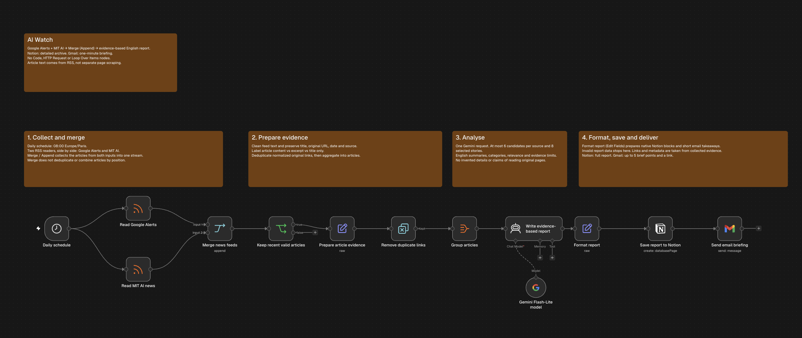

# Veille IA automatisée avec n8n

Projet réalisé dans le cadre d’un cours : créer un workflow de veille sur l’intelligence artificielle, puis documenter sa conception et sa réalisation.

## Objectif

Collecter des articles issus de deux flux RSS, en produire une synthèse en anglais avec Google Gemini, archiver le rapport détaillé dans Notion et envoyer un résumé par Gmail.

## Aperçu du workflow

## Fonctionnement

Le déclenchement quotidien lance en parallèle la lecture de Google Alerts et de MIT News. Le nœud **Merge** rassemble les deux flux, puis le workflow filtre les articles récents, prépare les informations utiles et supprime les liens en double.

Gemini rédige ensuite une synthèse à partir des éléments fournis par les flux RSS. Le rapport détaillé est enregistré dans Notion et un bref résumé accompagné d’un lien est envoyé par Gmail.

Les flux RSS fournissent les textes utilisés pour l’analyse : le workflow ne récupère pas séparément le contenu complet des pages des articles. Les affirmations de la synthèse doivent donc être vérifiées auprès des sources.

## Contenu du dépôt

| Dossier | Contenu |
|---|---|
| [`workflows/`](workflows/) | Le workflow n8n en TypeScript : [`workflow.ts`](workflows/workflow.ts). |
| [`skills/`](skills/) | Les trois skills utilisés pour structurer le travail avec l’assistant IA. |
| [`videos/`](videos/) | Emplacement prévu pour la vidéo de démonstration. |

### Les trois skills

1. [**interview**](skills/interview/SKILL.md) : clarifier le besoin et préparer une spécification.
2. [**doubt-driver-dev**](skills/doubt-driver-dev/SKILL.md) : développer la solution et vérifier son comportement.
3. [**hostile-review**](skills/hostile-review/SKILL.md) : examiner le résultat, repérer les défauts et les limites.

Ces skills sont des consignes pour l’assistant de développement. Ils ne s’importent pas comme des nœuds n8n.

## Configuration

Le fichier TypeScript publié ne contient pas de références personnelles ou d’identifiants de connexion. Pour utiliser le workflow dans votre environnement, configurez dans n8n les flux RSS, les accès Gemini, Notion et Gmail, ainsi que la source de données Notion et le destinataire de l’e-mail. Le fuseau horaire est réglé sur **Europe/Paris**.

Le workflow est fourni au format TypeScript généré avec **n8ncli**. Ce fichier sert à lire et versionner la définition du workflow avec l’outillage n8n correspondant.

## Vidéo de démonstration

La vidéo de présentation sera ajoutée dans [`videos/`](videos/). Elle montrera le workflow et expliquera ses principales étapes.
